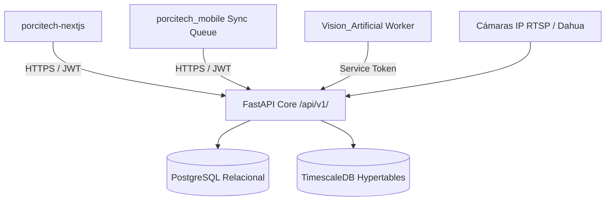

# PorciTech API Core — Backend Transaccional, Series Temporales & RTSP

Núcleo transaccional del ecosistema **PorciTech** construido con **FastAPI**, **PostgreSQL** y **TimescaleDB**. Expone una API REST versionada (`/api/v1/`) con autenticación JWT, control de acceso basado en roles (RBAC), almacenamiento de series temporales para curvas de crecimiento e ingesta de flujos de cámaras IP (`RTSP/Dahua`).

- **Caso de estudio técnico:** [santiagoavirama.dev/proyectos/porcitech](https://santiagoavirama.dev/proyectos/porcitech)
- **Repositorios conectados:** [`porcitech-nextjs`](https://github.com/DevAvirama/porcitech-nextjs) • [`Vision_Artificial`](https://github.com/DevAvirama/Vision_Artificial) • [`porcitech_mobile`](https://github.com/DevAvirama/porcitech_mobile)

---

## Arquitectura del Sistema



### Decisiones de Diseño y Seguridad

- **Arquitectura Monotenencia (_Single-Tenant_):** Modelo de datos optimizado para la operación de una unidad productiva institucional, unificando **corrales y lotes** en una sola entidad transaccional para eliminar redundancia referencial.
- **RBAC Estricto de 3 Niveles:** Autorización granular mediante dependencias de FastAPI para los roles **`ADMINISTRADOR`**, **`VETERINARIO`** y **`OPERARIO`**.
- **Persistencia Híbrida Relacional + Series de Tiempo:** Integridad ACID en PostgreSQL para eventos sanitarios/reproductivos combinada con _hypertables_ de TimescaleDB para registros históricos de pesaje manual y biométrico.

---

## Estructura del Repositorio

```text
api_porcitech/
├── app/                # Núcleo FastAPI: endpoints /api/v1/, modelos, esquemas Pydantic y seguridad RBAC
├── deploy/             # Configuración y manifiestos para despliegue contenerizado
├── scripts/            # Automatización multiplataforma (Linux/Windows) e inicialización de DB
├── weights/            # Artefactos y pesos auxiliares de validación
├── Dockerfile          # Construcción de imagen reproducible para producción
├── main.py             # Punto de entrada ASGI (Uvicorn)
├── requirements.txt    # Dependencias fijadas de Python
└── .env.example        # Plantilla de configuración de entorno
```

---

## Variables de Entorno

| Variable                      | Descripción                                        | Requerida |
| :---------------------------- | :------------------------------------------------- | :-------- |
| `DATABASE_URL`                | Cadena de conexión PostgreSQL / TimescaleDB        | Sí        |
| `JWT_SECRET_KEY`              | Clave criptográfica para firma de tokens de acceso | Sí        |
| `JWT_ALGORITHM`               | Algoritmo de firma (por defecto `HS256`)           | Sí        |
| `ACCESS_TOKEN_EXPIRE_MINUTES` | Tiempo de expiración de sesión                     | Sí        |
| `CORS_ORIGINS`                | Lista de orígenes autorizados (`porcitech-nextjs`) | Sí        |

---

## Despliegue Rápido

### Con Docker (Recomendado)

```bash
git clone [https://github.com/DevAvirama/api_porcitech.git](https://github.com/DevAvirama/api_porcitech.git)
cd api_porcitech
cp .env.example .env
docker build -t porcitech-api .
docker run -d --name porcitech-api --env-file .env -p 8000:8000 porcitech-api
```

### Entorno Local con `uv`

```bash
uv venv && source .venv/bin/activate
uv pip install -r requirements.txt
uvicorn main:app --host 0.0.0.0 --port 8000 --reload
```

Documentación interactiva OpenAPI disponible en `http://localhost:8000/docs`.
